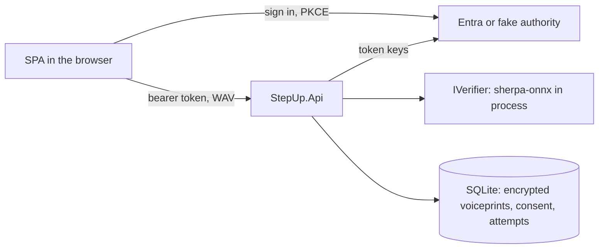

# voice-step-up

Voice step-up for Microsoft Entra ID. A user who is already signed in to Entra says a random phrase. A self-hosted speaker verifier (sherpa-onnx with a WeSpeaker model) and a speech check (Whisper) judge it, and the ASP.NET Core API answers with a short-lived signed assertion that carries `amr: ["vbm"]`. If voice fails or is not available, fresh Entra MFA is the fallback. The front end is a React/Vite SPA and the Entra setup is in-house Graph Bicep.

**This is a demonstrator, not a conformant authenticator.** NIST SP 800-63B-4 says "Biometric comparison based on voice SHALL NOT be used" as a biometric authenticator. Read [Limits](#limits) before you quote any number from this repository.

## Run the demo

You need Docker and nothing else: no Entra tenant, no account.

```bash
docker compose up --build --wait
```

The first build downloads the speaker and speech models (about 450 MB, every file checked against `models/models.lock`) and takes several minutes. Then open <http://localhost:5173>, pick a demo identity, give consent, record three enrollment phrases, and make a payout that needs a voice step-up. Say the six words shown on screen. A wrong phrase or a rejected voice offers the fallback, which signs in again with a fresh multi-factor claim (the fake authority simulates it).

Three services start, all bound to `127.0.0.1`:

| Service | Port | What it is |
|---|---|---|
| `web` | 5173 | The built SPA |
| `api` | 5000 | `StepUp.Api` with the real speaker verifier |
| `authority` | 5100 | `StepUp.FakeAuthority`, an offline sign-in stand-in that mints any demo identity by design |

Check it from the command line with `node scripts/demo-smoke.mjs` (health endpoints, then a real sign-in and an authenticated API call). Stop and delete the data with `docker compose down -v`.

The fake authority and fake sign-in exist only for this demo. The API refuses to start in fake mode unless `Demo:Enabled=true` and the environment is Development or Demo.

### Against a real Entra tenant

1. Put `VOICE_STEPUP_TENANT` and `VOICE_STEPUP_SUBSCRIPTION` in a git-ignored `.env.local` at the repository root. Tenant and client ids are never committed.
2. `scripts/entra-deploy.sh` creates the two app registrations (an API app and a SPA app) and writes their client ids to `.env.local`. `scripts/entra-teardown.sh` removes them. Both check the signed-in tenant first. Details and limits: `docs/entra-setup.md`.
3. `scripts/fetch-models.sh` downloads the models.
4. `scripts/demo-entra.sh` starts the API in Entra mode with the real verifier and serves the SPA, with the client ids from `.env.local` and without printing them.

## How it works



1. **Enroll.** After consent and a fresh Entra MFA, the user speaks three phrases. The service stores one encrypted voiceprint (the average of the three speaker embeddings). Samples that do not agree with each other are rejected.
2. **Challenge.** For a high-risk action the API issues a single-use six-word phrase, valid for 60 seconds.
3. **Verify.** The browser sends one 16 kHz mono WAV. The verifier returns a speaker embedding and a transcript. The API checks the transcript against the phrase and the cosine score against the stored threshold. Both checks always run, and a failure gives one generic answer.
4. **Assert.** On a pass the API signs an ES256 JWT (`typ` `stepup+jwt`, `amr` `["vbm"]`, bound to the user, the action and, for payouts, the amount and payee). It is valid for 5 minutes and works once, together with the user's bearer token.
5. **Fall back.** If voice fails, times out or errors, the endpoint accepts fresh Entra MFA instead: `amr` has `mfa` or `ngcmfa` and `auth_time` is within 10 minutes. Every failure path ends here and never in a pass.

Design: `docs/architecture.md`. Decisions: `docs/adr/` (eight ADRs). Verifier design and latency: `docs/design/verifier.md`.

## Results

These are the false-accept and false-reject rates of the **speaker score alone**, measured on LibriSpeech `test-clean` (40 speakers, read audiobook speech). The threshold was chosen on a different set, `dev-clean`, and frozen before `test-clean` was scored. Source: `docs/eval-report.md`; reproduce with `scripts/eval.sh`.

| Condition | Threshold | False accept | False reject (speaker-level bootstrap 95%) | Equal error rate |
|---|---|---|---|---|
| 4-word challenge, about 2 s probe (first design) | 0.79 | 2.04% | 43.28% (37.84% to 48.51%) | 10.69% |
| **6-word challenge, about 3 s probe (shipped)** | 0.80 | 2.18% | **23.82%** (19.53% to 28.34%) | 7.67% |
| 8-word challenge, about 4 s probe (not adopted) | 0.81 | 2.21% | 19.24% (15.17% to 23.65%) | 6.73% |

What the table does and does not say:

- About 1 genuine attempt in 4 is sent to the fallback by the speaker check alone, so the fallback is a normal path.
- Seconds per word are an assumption (running audiobook speech); spoken challenge words were not measured.
- Genuine probes come from the same sessions as the enrollment audio, so false-reject rates are optimistic.
- ASR rejects are not included, so this is not the false-reject rate of the whole product.
- 40 speakers cannot show a false-accept rate of 1 in 10,000, and nothing here claims it.

## Threat model

Full model with code anchors and test names: `docs/threat-model.md`. In short:

- **Replay.** A single-use random phrase and the speech check stop a whole earlier recording of a different phrase. They do not stop a recording that differs by one word: the letter-similarity rule accepts such a phrase 85.02% (`dev-clean`) and 87.00% (`test-clean`) of the time. A per-word rule was built and evaluated and is off because no setting met its gate.
- **Splicing and cloning.** Words spliced from the victim's recordings, and a cloned or converted voice that reads the phrase, can pass. There is no anti-spoofing and no presentation attack detection. These are stated limits.
- **Enrollment abuse.** Enrolling or replacing a voiceprint needs recorded consent and fresh MFA, and samples must agree at a consistency floor.
- **Downgrade.** The fallback requires `auth_time` within the window and never trusts `iat`. It was checked once against a live tenant with one TOTP user (ADR-0004).
- **Forgery and confusion.** Assertions are ES256, single use, bound to user, action and payload, and use their own audience and type, so an Entra token and an assertion cannot stand in for each other.
- **Threshold tampering.** Analyst-only, bounded below by a floor and recorded with who changed it.
- **Brute force.** 5 failed voice attempts give a 30 s delay and 50 disable voice for that user. At the 2.18% false-accept rate, 50 attempts would pass at least once about 67% of the time if they were independent (unverified).
- **Audio handling.** Audio is limited to 1 MB and 10 s, checked before it is read, rate limited, and fails closed on any verifier error. The application code writes no logs of its own.

## Privacy and consent

Voice is special-category data under GDPR Article 9. This project is not legal advice.

- **What is collected.** The recording you speak is held in memory for one request and then discarded; it is never written to disk, a database or a log. The service keeps a voiceprint (a numeric speaker embedding, not audio), a consent record, and an attempt log (time, action, score, threshold, result, reason code) under a pseudonymous user key.
- **Why.** To verify your voice as a second factor for high-risk actions.
- **Consent.** Enrollment needs explicit consent, shown with what is collected, how long it is kept, that you can withdraw, and that an alternative exists. The consent text is `web/src/screens/Consent.tsx`.
- **Alternative.** Fresh Entra MFA is always offered. Voice is never the only factor.
- **Retention.** The voiceprint is kept until you delete it or withdraw consent. Withdrawing consent and deleting the voiceprint is one action with one confirmation. It removes the voiceprint row (the database runs with `secure_delete`) and your in-progress enrollments, marks your consent withdrawn (the consent record stays as proof that it was given), and re-keys your attempt rows to random tokens. The attempt rows are kept without any link to you; they are pseudonymised, not deleted.
- **Storage.** Voiceprints are encrypted at rest with ASP.NET Core Data Protection and tagged with the model that produced them. A different model fails closed and asks you to enroll again.

## Limits

1. **Demonstrator, not a conformant authenticator.** NIST SP 800-63B-4 says voice comparison SHALL NOT be used as a biometric authenticator. Nothing here conforms to it.
2. **Central verification.** The comparison happens on the server. NIST prefers comparison on the user's device, because central verification raises the impact of a breach.
3. **Speaker score only.** The evaluation covers read speech from 40 + 40 speakers. Its intervals are wide, and it says nothing about microphones, browsers, rooms or accents.
4. **No anti-spoofing.** There is no liveness or presentation attack detection. The single-use phrase gives whole-clip replay resistance only. Splicing and cloning are open (TM-001, TM-001b, TM-002).
5. **Brute force.** See the estimate under [Threat model](#threat-model). The 5 / 30 s / 50 limits are the NIST ceiling for a system without presentation attack detection and are configurable.
6. **The fallback is used often.** About a quarter of genuine attempts, before ASR rejects.
7. **One live check.** The Entra fallback rule was checked once, with one TOTP user. `ngcmfa` was not issued to that user, so the rule accepts `mfa`.
8. **The offline demo's sign-in is fake** and mints any identity. It must not face a network.
9. **Not hardened for production.** The code had independent review passes during development, but CI has no general secret scan (only a tenant-id check) and no image-layer check, and the deployment shape (single instance, SQLite, local key ring) is a demo's.

## Environment

<!-- AUTO-GENERATED from scripts/lib-entra.sh and web/src/config.ts by /update-docs -->

The Entra scripts read these from the environment or from the git-ignored `.env.local` (the environment wins). The offline demo needs none of them.

| Variable | Required | Description |
|---|---|---|
| `VOICE_STEPUP_TENANT` | Yes | Entra tenant id; every script asserts the signed-in tenant equals it before any change |
| `VOICE_STEPUP_SUBSCRIPTION` | Yes | Azure subscription id passed to every `az` call |
| `VOICE_STEPUP_API_CLIENT_ID`, `VOICE_STEPUP_SPA_CLIENT_ID`, `VOICE_STEPUP_API_SCOPE` | After deploy | Written by `scripts/entra-deploy.sh`; read by `scripts/demo-entra.sh` |
| `VOICE_STEPUP_RG` | No | Resource group, default `rg-voice-step-up` |
| `VOICE_STEPUP_API_UNIQUE_NAME`, `VOICE_STEPUP_SPA_UNIQUE_NAME` | No | Fixed keys of the two app registrations, defaults `voice-step-up-api` and `voice-step-up-spa` |
| `AZ` | No | Path to the Azure CLI when `az` is not on `PATH` |

The SPA reads build-time variables, set for you by the compose file and `scripts/demo-entra.sh`: `VITE_AUTH_MODE` (`fake` or `entra`, default `fake`), `VITE_API_BASE` (default `http://localhost:5000`), `VITE_AUTHORITY` (default `http://localhost:5100`), `VITE_CLIENT_ID` and `VITE_API_SCOPE`.

<!-- END AUTO-GENERATED -->

## Build and test

```bash
dotnet build
dotnet test -- --filter-not-trait "Category=Model"   # unit and API tests, no models needed
scripts/fetch-models.sh                               # about 450 MB, checked against models/models.lock
dotnet test -- --filter-trait "Category=Model"        # tests that run the real models
cd web && npm ci && npm test && npm run lint          # SPA unit tests
cd web && npx playwright install chromium && npx playwright test   # browser journey on the offline stack
```

The browser journey runs against the Fake verifier, which ignores speech and reads a stand-in payload that the test injects into the request. It tests the flow, not the voice.

Requires the .NET SDK pinned in `global.json` and Node 24. CI (`.github/workflows/ci.yml`) runs build and tests, the SPA checks, the Bicep build and lint, the browser journey, the demo (compose up, health, sign-in), and actionlint.

## Documents

| Path | What |
|---|---|
| `docs/architecture.md` | Components, sequences, data model, API contract |
| `docs/adr/` | Decisions D1 to D11 as ADRs 0001 to 0008 |
| `docs/threat-model.md` | Threats, controls with code anchors, tests |
| `docs/eval-report.md`, `docs/design/evaluation-protocol.md` | Measured rates and the protocol fixed before them |
| `docs/design/verifier.md` | Verifier design, quality gates, latency |
| `docs/design/honest-claims.md` | What this project may and may not claim |
| `docs/entra-setup.md` | The Entra app registrations and their limits |

## Attributions and licence

MIT, see `LICENSE`. Third-party models, libraries and data sets, with their licences, are listed in `NOTICE`: sherpa-onnx (Apache-2.0), ONNX Runtime (MIT), the WeSpeaker ResNet34-LM model (CC BY 4.0), Whisper base.en (MIT), LibriSpeech (CC BY 4.0), and the Piper voice used for test fixtures (CC BY 4.0).
