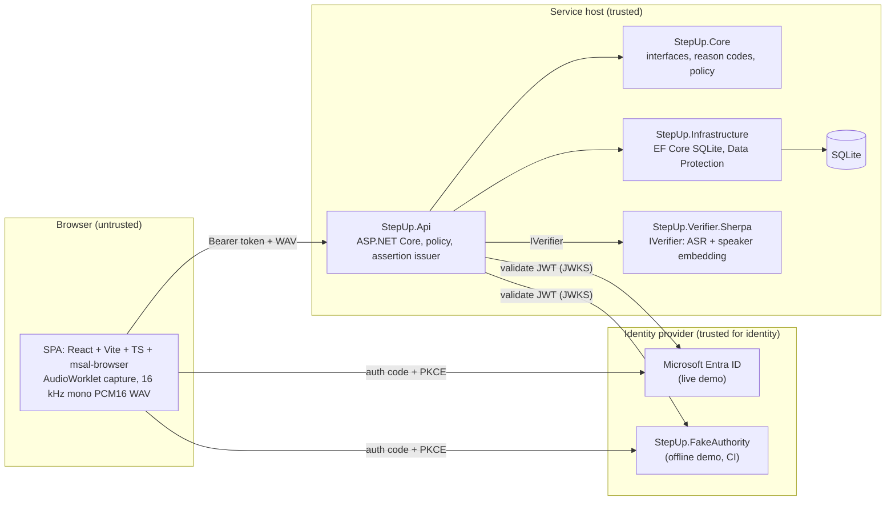
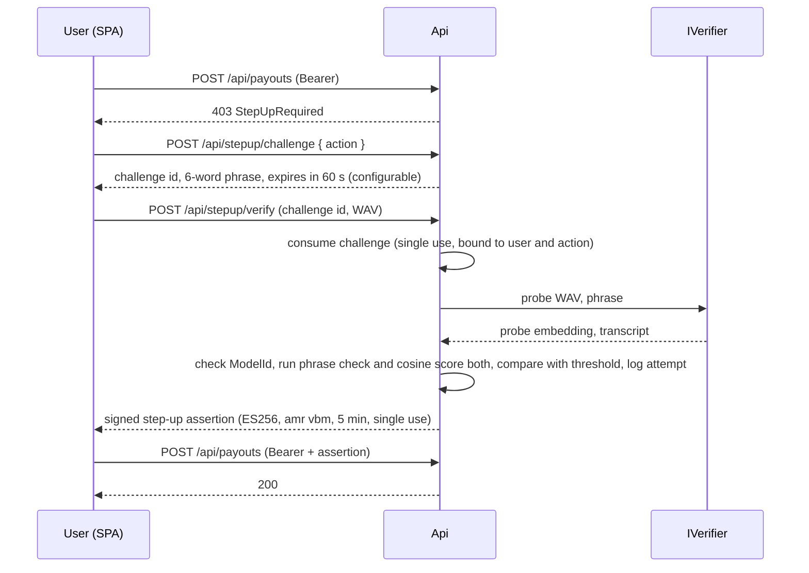
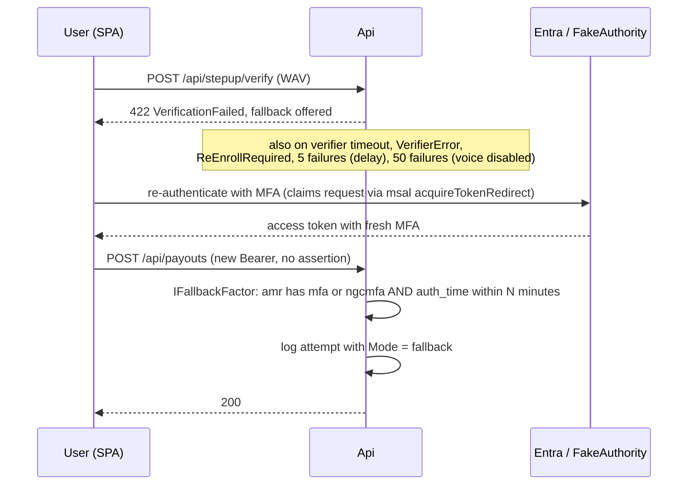
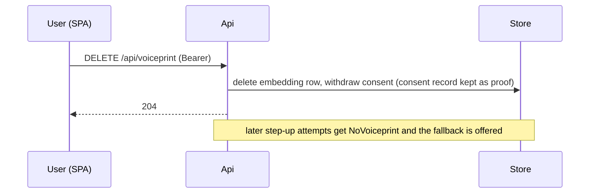
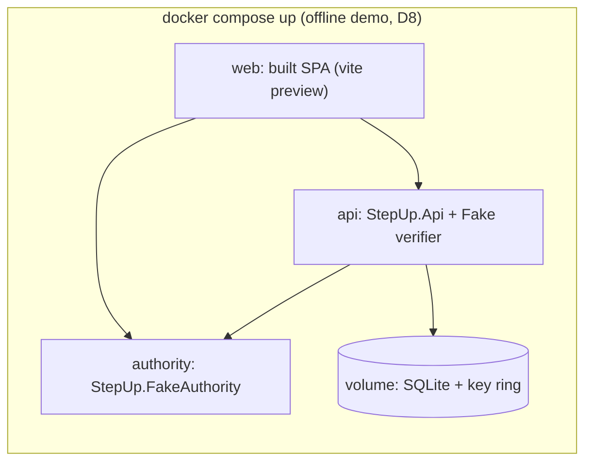

# Architecture

Status: v2, checked against the code in M8 (v1 was the design-level draft after the T1.4 panel review). Decisions D1 to D11 are in `docs/adr/`; the threat model is `docs/threat-model.md`. The two spikes it names (ASR in M3 T3.1, Entra claims in M5 T5.4) have run; their results are in ADR-0002 and ADR-0004.

voice-step-up is a demonstrator, not a conformant authenticator (NIST SP 800-63B-4 says voice comparison SHALL NOT be used as a biometric authenticator). Voice is one step-up factor on top of an Entra ID sign-in, never the only one.

## 1. Components and trust boundaries



Required controls at each boundary (design commitments, not yet built):

| Boundary | Crosses it | Required controls |
|---|---|---|
| Browser to Api | Bearer token, WAV upload, challenge id | Untrusted input. Validate token (below), size, format, challenge binding. CORS allowlist of the SPA origin only. No cookies, so CSRF does not apply. |
| Api to IdP | JWKS and discovery fetch | TLS. Validate issuer, audience, `tid`, signature, lifetime, `scp`; analyst endpoints need the `Analyst` app role in `roles`; reject app-only tokens (`idtyp` = `app`). |
| Api to Verifier | WAV bytes, phrase | In-process by default (D1). `HttpVerifier`: loopback or compose network only, shared-secret header, bodies never logged. The verifier returns the probe embedding and the transcript; the Api computes the score (D3), so a spoofed verifier cannot return a bare pass. Timeout fails closed. |
| Api to SQLite | Embeddings, attempts, consent | Embeddings encrypted with Data Protection (D7). No raw audio persisted anywhere. `PRAGMA secure_delete = ON`. |

Token validation:
- Entra mode: `AddMicrosoftIdentityWebApi` with the single tenant GUID (never `common`), `Audience` = the API's App ID URI, `RequiredScope`. Pin the token version (v2 issuer `https://login.microsoftonline.com/{tid}/v2.0`).
- Fake mode: `AddJwtBearer` with the same `TokenValidationParameters` shape, so CI runs the same checks.
- Both modes: `MapInboundClaims = false`, so `amr`, `oid`, `tid`, `auth_time` keep their short names.
- Entra mode accepts exactly one issuer and one `tid`. It never trusts the fake issuer. Fake mode starts only with an explicit demo flag in Development or on a loopback or compose network (TM-013). The fake signing key is generated per run.
- The step-up assertion has its own handler (section 4). The Entra bearer handler rejects it, and the assertion handler rejects Entra tokens. A `vbm` value inside an Entra token is never treated as the voice step-up; only a validated service assertion counts.

Projects: `StepUp.Core` (no I/O), `StepUp.Infrastructure` (persistence), `StepUp.Api` (HTTP, auth, policy wiring), `StepUp.Verifier.Sherpa` (M3), `StepUp.FakeAuthority` (M2). The SPA lives in `web/` (M4).

## 2. Sequences

### 2.1 Enrollment

```mermaid
sequenceDiagram
  participant U as User (SPA)
  participant A as Api
  participant V as IVerifier
  participant S as Store
  U->>A: POST /api/enrollment/consent (Bearer)
  A->>S: write consent record (user, text version, time)
  U->>A: POST /api/enrollment/start (Bearer with fresh MFA)
  A-->>U: enrollment id (bound to the user), phrases to read
  loop each sample (3, configurable)
    U->>A: POST /api/enrollment/sample (WAV)
    A->>V: quality gate + ASR phrase check + embedding
    V-->>A: embedding, transcript or reason code
    A-->>U: accepted or reason code
  end
  U->>A: POST /api/enrollment/complete
  A->>A: L2-normalise each embedding, mean, normalise again; reject if any pairwise cosine is below the consistency floor
  A->>S: atomic swap of the stored voiceprint (encrypted, model id)
  A-->>U: enrolled
```

Without a consent record the API answers `ConsentMissing` on `start`, `sample` and `complete`, so consent withdrawn mid-enrollment stores nothing. Enrollment phrases come from a separate word list that shares no word with the challenge list, so enrollment audio gives an attacker none of the words a later challenge asks for. Starting or replacing an enrollment needs a bearer token with fresh MFA under the same rule as the fallback (section 2.3), otherwise `FreshMfaRequired`. Replacing a voiceprint is delete plus enroll; there is no adaptive template update (poisoning risk), so a user whose voice changed re-enrolls.

### 2.2 Step-up pass



The assertion is valid only together with a valid bearer token for the same `oid` and `tid`, only for the `act` it was issued for, and only once (D5, ADR-0005).

### 2.3 Step-up fail with fallback



Fallback rule (ADR-0004), behind `IFallbackFactor` and configuration so the M5 spike can change it without touching the policy code:
- `amr` contains `mfa` or `ngcmfa`, and `auth_time` is within N minutes (default 10, configurable).
- `iat` is never a proxy: a silent refresh gives a new `iat` while `amr` keeps the old MFA. If `auth_time` is missing the rule fails closed.
- The API app registration must declare `optionalClaims.accessToken` = `amr`, `auth_time` and `requestedAccessTokenVersion: 2` (M5 Bicep scope).
- Checked in the live spike (M5 T5.4, ADR-0004; one TOTP user, one run): the claims request `{"access_token":{"amr":{"essential":true,"values":["ngcmfa"]}}}` forced a new MFA prompt in a live SSO session and moved `auth_time` forward, and `ngcmfa` was not issued to a TOTP user (the token carried `totp` and `mfa`), so the rule keeps accepting `mfa`. FIDO2-only users were not tested.
- `/api/payouts` passes on (valid assertion) OR (`IFallbackFactor` says fresh MFA).

### 2.4 Consent withdrawal and deletion



Withdrawal is one call, as easy as consent. The consent record stays as evidence; the voiceprint does not. Withdrawal also deletes the user's in-progress enrollments (their sample embeddings); expired enrollments are deleted when touched and on every `start`. Attempts are pseudonymised, not deleted: each of the user's rows gets its own random token in place of the `UserKey`, so scores stay for the analyst but cannot be linked to the person. That re-key is the only change an attempt row ever gets. An assertion issued before deletion stays valid for up to 5 minutes; that is stated as a limit.

## 3. Data model

Stored in SQLite through EF Core (D7). No raw audio, ever.

`UserKey` = HMAC-SHA256 (server secret) of `tid` + `oid`, so it cannot be reversed from known object ids.

`ModelId` = `wespeaker-resnet34-lm:<first 12 hex of the speaker model SHA-256 from models/models.lock>+sherpa-<package version>+<feature config version>`. Only the speaker model and the feature configuration change an embedding, so the ASR model is not part of it. A stored voiceprint with a different `ModelId` than the running one fails closed with `ReEnrollRequired` and the fallback is offered.

| Table | Columns | Notes |
|---|---|---|
| `Consents` | `Id`, `UserKey`, `TextVersion`, `GivenAt`, `WithdrawnAt?` | One active consent per user. |
| `Voiceprints` | `Id`, `UserKey`, `ModelId`, `EmbeddingProtected` (bytes), `CreatedAt` | Encrypted with Data Protection. One per user. Delete removes the row. |
| `Enrollments` | `Id`, `UserKey`, `SamplesProtected`, `ExpiresAt` | In-progress enrollment; the id is bound to the user. Short TTL. |
| `Attempts` | `Id`, `UserKey`, `At`, `Action`, `Score?`, `Threshold`, `ModelId`, `Result`, `ReasonCode?`, `Mode` (voice or fallback) | Analyst log. No update or delete path except the pseudonymise re-key on consent withdrawal. Detail codes (`PhraseMismatch`, `BelowThreshold`) live here, not in the client response. |
| `Challenges` | `Id`, `UserKey`, `Action`, `Phrase?`, `ExpiresAt`, `ConsumedAt?` | Single use. The phrase is nulled on consume or expiry. Open challenges per user are capped. |
| `UsedAssertions` | `Jti`, `ExpiresAt` | Makes the assertion single use. |
| `Thresholds` | `Id`, `Name`, `ModelId`, `Value`, `UpdatedAt`, `UpdatedBy` | Active threshold plus history. Value in 0.0 to 1.0 with a configurable floor. |
| Data Protection key ring and assertion signing key | Volume, outside the repo and image | Key-ring loss makes embeddings unreadable (re-enroll). |

Cohort normalisation would change what `Score` means. Adopt it only if the M6 protocol says so; then add a cohort-set id to `ModelId` and `Attempts`. Scores are never called calibrated.

## 4. API contract

All endpoints need `Authorization: Bearer <access token>` unless stated. Errors use RFC 9457 problem details with a `code` field from the reason codes below. Auth mode is `Auth:Mode` = `Entra` or `Fake`. The score and the threshold are never returned to the user role.

| Method and path | Role | Request | Success | Errors |
|---|---|---|---|---|
| `GET /api/me` | user | none | 200 `{ oid, tid, name, enrolled, consent }` | 401 |
| `POST /api/enrollment/consent` | user | `{ textVersion }` | 204 | 401, 409 already given |
| `POST /api/enrollment/start` | user, fresh MFA | none | 200 `{ enrollmentId, phrases[], samplesNeeded }` | 401, 403 `ConsentMissing` `FreshMfaRequired` |
| `POST /api/enrollment/sample` | user | query `enrollmentId`; body `audio/wav` (PCM16 mono 16 kHz, max 10 s, max 1 MB) | 200 `{ accepted, reason? }` | 400 `TooShort` `Muted` `Noisy` `PhraseMismatch`, 403 other user's enrollment id, 413, 415, 429 |
| `POST /api/enrollment/complete` | user, fresh MFA | query `enrollmentId` | 200 `{ enrolled: true }` | 403 `FreshMfaRequired`, 409 not enough samples, 422 inconsistent speakers |
| `DELETE /api/voiceprint` | user | none | 204 (deletes embedding, withdraws consent) | 401 |
| `POST /api/stepup/challenge` | user | `{ action }` | 200 `{ challengeId, phrase, expiresAt }` | 403 `NoVoiceprint` `ConsentMissing` `ReEnrollRequired`, 429 `RateLimited` |
| `POST /api/stepup/verify` | user | query `challengeId`, `action`, and for `payout` also `amount` and `to`; body `audio/wav` | 200 `{ assertion, expiresAt }` on pass; 422 `{ code: VerificationFailed, fallback }` on fail | 400 audio reasons, 410 `ChallengeExpired` `ChallengeConsumed`, 429 `RateLimited`, 503 `VerifierError` `Timeout` with fallback instruction |
| `GET /api/analyst/attempts` | analyst role | query: `from`, `to`, `result`, paging | 200 list of attempts | 401, 403 |
| `GET /api/analyst/thresholds` | analyst role | none | 200 thresholds | 401, 403 |
| `PUT /api/analyst/thresholds` | analyst role | `{ name, value }` | 200 | 400 out of range, 401, 403 |
| `POST /api/payouts` | user + step-up | `{ amount, to }` and `X-StepUp-Assertion` (bound to the same amount and payee) or a fresh-MFA bearer | 200 | 403 `StepUpRequired` |
| `GET /healthz` | none | none | 200 `{ status: "ok" }` | none |

Reason codes: `Muted`, `TooShort`, `Noisy` (also covers clipping), `PhraseMismatch`, `BelowThreshold`, `Timeout`, `VerifierError`, `NoVoiceprint`, `ConsentMissing`, `ChallengeExpired`, `ChallengeConsumed`, `RateLimited`, `StepUpRequired`, `FreshMfaRequired`, `ReEnrollRequired`, `VerificationFailed`. Two more exist for the attempt log only and are never sent: `AssertionReplayed` and `AssertionInvalid`. The client sees only `VerificationFailed` for `PhraseMismatch` and `BelowThreshold`; both checks always run, so timing does not tell them apart. The detail goes to the attempt log.

Step-up assertion (D5, ADR-0005): JWT, header `typ` = `stepup+jwt`, `alg` = ES256, `kid`; claims `iss` = this service, `aud` = the service's step-up audience (never the Entra App ID URI), `sub` = `oid`, `tid`, `amr: ["vbm"]`, `act` = action, optional `ph` = hash of `amount` and `to`, `jti`, `iat`, `exp` (5 minutes). The handler uses only the service's own key set, accepts only ES256, and rejects `none`, HS256 and unknown `kid`. It is single use (`UsedAssertions`) and valid only with a bearer for the same `oid` and `tid`. The signing key is generated at first start, protected with Data Protection in the key-ring volume, never in the repo or image; rotation is manual (a demo limit).

Attempt limits (NIST SP 800-63B-4 section 3.2.3.3 for a system without presentation attack detection, configurable): after 5 consecutive failed voice attempts a delay of at least 30 s; after 50, voice is disabled for that user and the fallback is offered. The counter resets on any successful step-up, a voice pass or a fresh-MFA fallback pass. Only decided voice attempts count; a request turned away before a decision (no voiceprint, no consent, locked out, expired or used challenge, missing or bad assertion) is logged as `Refused` with its reason and never feeds the counter. A disabled user is re-enabled by re-enrolling with fresh MFA. A quality rejection does not consume the challenge but counts toward the general rate limit. Per-user rate limits apply to `sample`, `challenge` and `verify`; open challenges per user are capped; a global verifier concurrency limit answers 429. A per-IP limit is secondary only. Effect of the measured false reject of about 24% at a 3 s probe (6-word challenge, test-clean; 43% at the earlier 4 words and 2 s): an honest user fails five attempts in a row about 0.08% of the time if attempts were independent (UNVERIFIED, the rate varies by speaker), so the delay is rare and roughly 1 genuine attempt in 4 reaches the fallback. A stricter cap (for example disabling voice after about 10 failures) is allowed by NIST and is a configuration choice, not applied.

Settled in M2: the verify call for `payout` carries `amount` and `to`, so the issued assertion has `ph` and cannot pay anything else. A presented assertion that does not match is refused without being consumed, so the user who stepped up can still use it for the matching request. Parallel verifications are limited only by the open-challenge cap (3), so a lockout can be overrun by at most that many in-flight attempts; this is a stated limit.

## 5. Verifier and replay resistance

`IVerifier` takes a WAV and the expected phrase and returns the probe embedding, the transcript and a reason code. The Api computes the cosine score against the stored embedding (D3). The default `Sherpa` implementation runs in-process (D1): an offline ASR recognizer checks the spoken phrase (D2) and a WeSpeaker model gives the embedding. `HttpVerifier` shows the swap to an out-of-process verifier.

The random phrase plus the ASR check gives replay resistance against re-submitting a whole earlier recording. This is not liveness and not presentation attack detection. Two attacks are not stopped: words spliced from recordings of the victim saying each word (phrases come from a fixed word list; past attempts are a source; enrollment phrases are not, because they use a separate word list), and real-time voice conversion or a text-to-speech clone that reads the phrase. The 60 s window is configurable; shortening it would not stop either attack. The phrase rule is also looser than word match: M6 measured that a phrase with one wrong word is accepted 87% of the time (test-clean), so splicing needs fewer than the 6 words of the phrase (the rate was measured on sentences of 3 to 6 words, not on challenge phrases). The per-word rule that would narrow this is implemented and off, because no floor met its gate (ADR-0002, Amendment 2). These are stated limits.

The ASR is Whisper base.en. A phrase matches at a letter-level similarity of 0.60 or higher between transcript and phrase (ADR-0002, `docs/design/verifier.md` section 5), not at exact word equality, because Whisper splits and merges isolated nouns. The API runs the verifier in one of three modes, `Verifier:Mode` = `Sherpa` (in-process, models checked against `models/models.lock` at startup), `Http` (a remote verifier on loopback, a compose service name or https; wire format in `HttpVerifier`) or `Fake` (demo only).

Quality gates have numeric values in `docs/design/verifier.md` (M3). `TooShort` measures net speech after voice activity detection, not file length. Browser capture sets `echoCancellation`, `noiseSuppression` and `autoGainControl` to false and resamples with a low-pass filter.

## 6. Failure behavior

| Event | Behavior |
|---|---|
| Verifier timeout (default 3 s) or error | Fail closed, return the fallback instruction. Never pass. |
| Stored `ModelId` differs from the running one | `ReEnrollRequired`, fallback offered. |
| Audio too short, muted or noisy | Reject with a reason code before verification; the challenge is not consumed; logged; counts toward the rate limit. |
| Challenge expired or already used | 410, no verification. |
| No voiceprint or no consent | Fallback offered. |
| Token invalid, wrong tenant, app-only | 401. |

## 7. Deployment view



The default services need no models and no tenant; the API with the real Sherpa verifier is the `api-real` service under the `real` compose profile (its image fetches the models, checked against `models/models.lock`). `./scripts/demo-entra.sh` runs the API (real verifier) and the SPA against real Entra using the tenant and client ids from the untracked `.env.local` (never committed). The API reaches the authority as `http://authority:5100` while the browser uses `http://localhost:5100`; `FakeAuthority:PublicUrl` pins the issuer so both see the same keys. The SPA serves a CSP, keeps tokens out of `localStorage`, and the fake authority supports PKCE and CORS on its token endpoint so the offline demo matches Entra.

## 8. Design docs

Per the PRD (Documentation order): the verifier design (`docs/design/verifier.md`, written after the ASR spike), the evaluation protocol (`docs/design/evaluation-protocol.md`, committed before any result was seen, with its amendments) and the claims input for the README (`docs/design/honest-claims.md`). Others only when a part meets at least two of: security-sensitive, non-obvious, built by parallel implementers, expensive to change. M8 T8.3 checked this document against the code.

## 9. Review outcome (M1 T1.4)

Applied: fresh-MFA rule on `auth_time` only; fresh MFA for enrollment; assertion single use, action binding, own handler; signing-key handling; fake-mode guard; model-id pinning; uniform failure response; numeric gates and capture constraints deferred to M3; evaluation protocol requirements recorded in the M3 and M6 plans.

Rejected, with reasons:
- Cut the challenge TTL to 15 to 20 s: reading and recording a 6-word phrase needs the time, and a shorter window does not stop splicing or voice conversion. Kept 60 s, configurable; the limit is stated.
- Per-IP limits as the primary control: the stated attacker holds a valid token, so per-user limits are primary and per-IP is secondary.
- Architect F14 (TOTP automation in T5.4, ES256, threshold history as scope creep): each is cheap or already gated; no change.
- Architect F11 (PRD status column): partly applied. The M1 validation now checks `Decisions:` lines; README counts of 0 in the ADR grep are expected.
