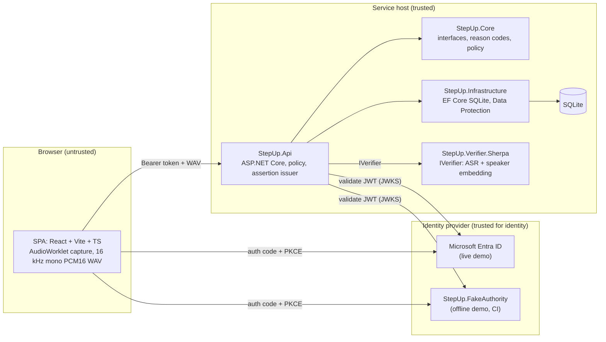
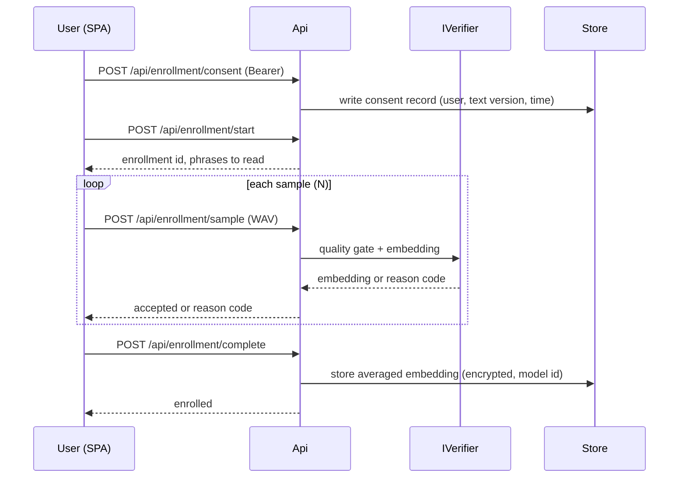
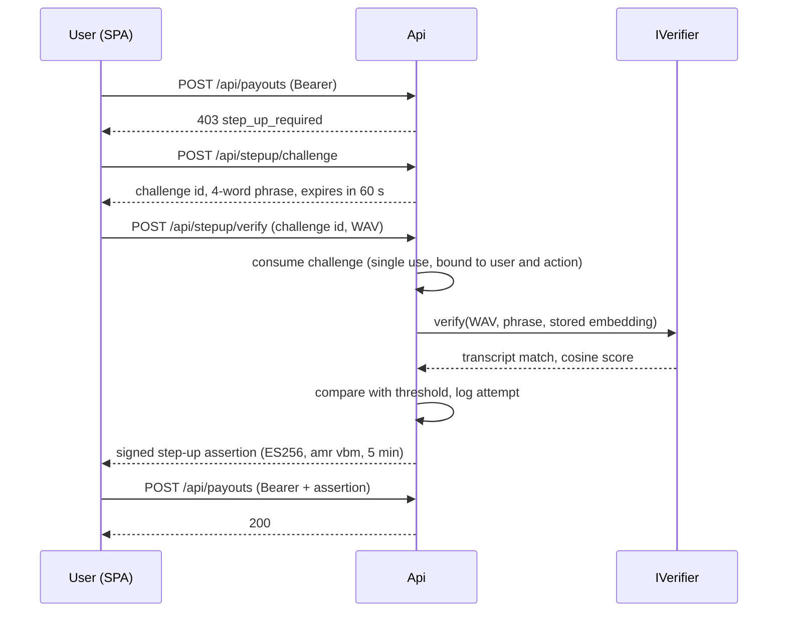
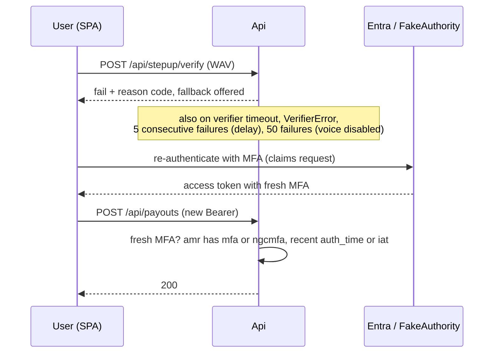
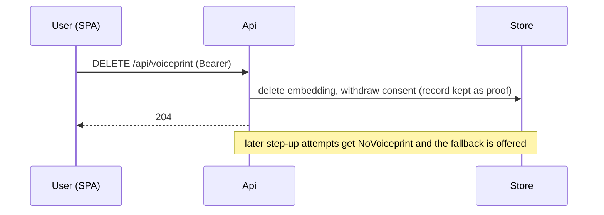
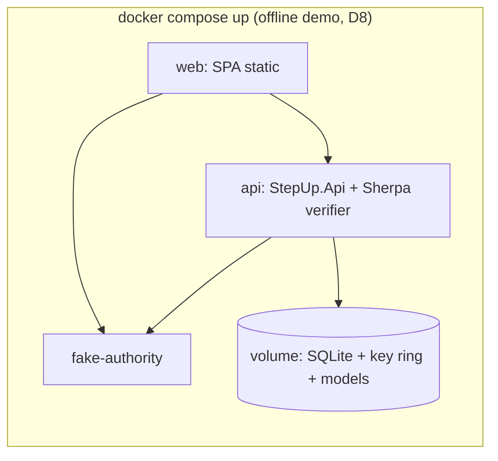

# Architecture

Status: v0, design level (M1). Nothing here is built yet. Decisions D1 to D11 are in `docs/adr/`; the threat model is `docs/threat-model.md`. Anything marked UNVERIFIED is settled later by the named spike.

voice-step-up is a demonstrator, not a conformant authenticator (NIST SP 800-63B-4 says voice comparison SHALL NOT be used as a biometric authenticator). Voice is one step-up factor on top of an Entra ID sign-in, never the only one.

## 1. Components and trust boundaries

Trust boundaries:

| Boundary | Crosses it | Rule |
|---|---|---|
| Browser to Api | Bearer token, WAV upload, challenge id | Everything is untrusted input: validate token, size, format, challenge binding. |
| Api to IdP | JWKS and discovery fetch | Validate issuer, audience, tenant (`tid`), signature, lifetime. |
| Api to Verifier | WAV bytes, phrase | In-process by default (D1). Over HTTP for `HttpVerifier`. Timeout fails closed (section 6). |
| Api to SQLite | Embeddings, attempts, consent | Embeddings encrypted with Data Protection (D7). No raw audio persisted anywhere. |

Projects: `StepUp.Core` (no I/O), `StepUp.Infrastructure` (persistence), `StepUp.Api` (HTTP, auth, policy wiring), `StepUp.Verifier.Sherpa` (M3), `StepUp.FakeAuthority` (M2). The SPA lives in `web/` (M4).

## 2. Sequences

### 2.1 Enrollment

Without a consent record the API answers `ConsentMissing` and stores nothing.

### 2.2 Step-up pass

The assertion is valid only together with a valid bearer token for the same `oid` and `tid` (D5).

### 2.3 Step-up fail with fallback

The acceptance rule is confirmed in the live tenant spike (M5 T5.4). It is UNVERIFIED until then (D6).

### 2.4 Consent withdrawal and deletion

Withdrawal is one call, as easy as consent. The consent record stays as evidence; the voiceprint does not.

## 3. Data model

Stored in SQLite through EF Core (D7). No raw audio, ever.

| Table | Columns | Notes |
|---|---|---|
| `Consents` | `Id`, `UserKey`, `TextVersion`, `GivenAt`, `WithdrawnAt?` | `UserKey` = hash of `tid` + `oid`. One active consent per user. |
| `Voiceprints` | `Id`, `UserKey`, `ModelId`, `EmbeddingProtected` (bytes), `CreatedAt` | Embedding encrypted with Data Protection. `ModelId` forces re-enrollment on a model change. One per user. |
| `Attempts` | `Id`, `UserKey`, `At`, `Score?`, `Threshold`, `Result`, `ReasonCode?`, `Mode` (voice or fallback) | Analyst log. No audio, no transcript text beyond the match flag. |
| `Challenges` | `Id`, `UserKey`, `Action`, `PhraseHash`, `ExpiresAt`, `ConsumedAt?` | Single use. The phrase is held server-side only until consumed or expired. |
| `Thresholds` | `Id`, `Name`, `Value`, `UpdatedAt`, `UpdatedBy` | Active threshold plus history for the analyst. |
| Data Protection key ring | Files or table, outside the repo | Key loss makes stored embeddings unreadable (re-enroll). |

## 4. API contract

All endpoints need `Authorization: Bearer <access token>` unless stated. Errors use RFC 9457 problem details with a `code` field from the reason codes below. Auth mode is `Auth:Mode` = `Entra` or `Fake`.

| Method and path | Role | Request | Success | Errors |
|---|---|---|---|---|
| `GET /api/me` | user | none | 200 `{ oid, tid, name, enrolled, consent }` | 401 |
| `POST /api/enrollment/consent` | user | `{ textVersion }` | 204 | 401, 409 already given |
| `POST /api/enrollment/start` | user | none | 200 `{ enrollmentId, phrases[], samplesNeeded }` | 401, 403 `ConsentMissing` |
| `POST /api/enrollment/sample` | user | `enrollmentId` + WAV (PCM16 mono 16 kHz, max 10 s, max 1 MB) | 200 `{ accepted, reason? }` | 400 `TooShort` `Muted` `Noisy`, 413, 415 |
| `POST /api/enrollment/complete` | user | `{ enrollmentId }` | 200 `{ enrolled: true }` | 409 not enough samples |
| `DELETE /api/voiceprint` | user | none | 204 (deletes embedding, withdraws consent) | 401 |
| `POST /api/stepup/challenge` | user | `{ action }` | 200 `{ challengeId, phrase, expiresAt }` | 403 `NoVoiceprint` `ConsentMissing`, 429 `RateLimited` |
| `POST /api/stepup/verify` | user | `challengeId` + WAV | 200 `{ assertion, expiresAt }` on pass; 422 `{ code, fallback }` on fail | 400 audio reasons, 410 `ChallengeExpired` `ChallengeConsumed`, 429 `RateLimited`, 503 `VerifierError` `Timeout` with fallback instruction |
| `GET /api/analyst/attempts` | analyst role | query: `from`, `to`, `result`, paging | 200 list of attempts | 401, 403 |
| `GET /api/analyst/thresholds` | analyst role | none | 200 thresholds | 401, 403 |
| `PUT /api/analyst/thresholds` | analyst role | `{ name, value }` | 200 | 400 out of range, 401, 403 |
| `POST /api/payouts` | user + step-up | `{ amount, to }` and `X-StepUp-Assertion` | 200 | 403 `step_up_required` |
| `GET /healthz` | none | none | 200 `{ status: "ok" }` | none |

Reason codes: `Muted`, `TooShort`, `Noisy`, `PhraseMismatch`, `BelowThreshold`, `Timeout`, `VerifierError`, `NoVoiceprint`, `ConsentMissing`, `ChallengeExpired`, `ChallengeConsumed`, `RateLimited`.

Step-up assertion (D5): JWT, ES256, claims `iss`, `aud`, `sub` = `oid`, `tid`, `amr: ["vbm"]`, `jti`, `iat`, `exp` (5 minutes). It is valid only with a bearer token whose `oid` and `tid` match.

Attempt limits (NIST SP 800-63B-4 section 3.2.3.3 for a system without presentation attack detection, configurable): after 5 consecutive failed voice attempts a delay of at least 30 s; after 50, voice is disabled for that user and the fallback is offered.

## 5. Verifier and liveness

`IVerifier` takes a WAV, the expected phrase and the stored embedding, and returns a score, a transcript-match flag and a reason code. The default `Sherpa` implementation runs in-process (D1): an offline ASR recognizer checks the spoken phrase (D2) and a WeSpeaker model gives an embedding; the service computes the cosine similarity itself (D3). `HttpVerifier` shows the swap to an out-of-process verifier.

Liveness is the server-issued random phrase plus the ASR transcript check plus the speaker score. A replayed recording fails the phrase check. A synthetic voice that reads the right phrase is not stopped by this design; that is a stated limit.

## 6. Failure behavior

| Event | Behavior |
|---|---|
| Verifier timeout (default 3 s) or error | Fail closed, return the fallback instruction. Never pass. |
| Audio too short, muted, clipped or noisy | Reject with a reason code before verification. No attempt counted against the limit for quality rejections, but still logged. |
| Challenge expired or already used | 410, no verification. |
| No voiceprint or no consent | Fallback offered. |
| Token invalid or wrong tenant | 401. |

## 7. Deployment view

`./scripts/demo-entra.sh` runs the same API and SPA against real Entra using the tenant and client id passed as parameters (never committed). Models are fetched by a checksum-verified script, not committed.

## 8. Optional design docs for later milestones

Per the PRD (Documentation order): a verifier design doc in M3 (after the ASR spike) and an evaluation-protocol doc in M6 (before any result is seen). Others only when a part meets at least two of: security-sensitive, non-obvious, built by parallel implementers, expensive to change. M8 checks this document against the code.
