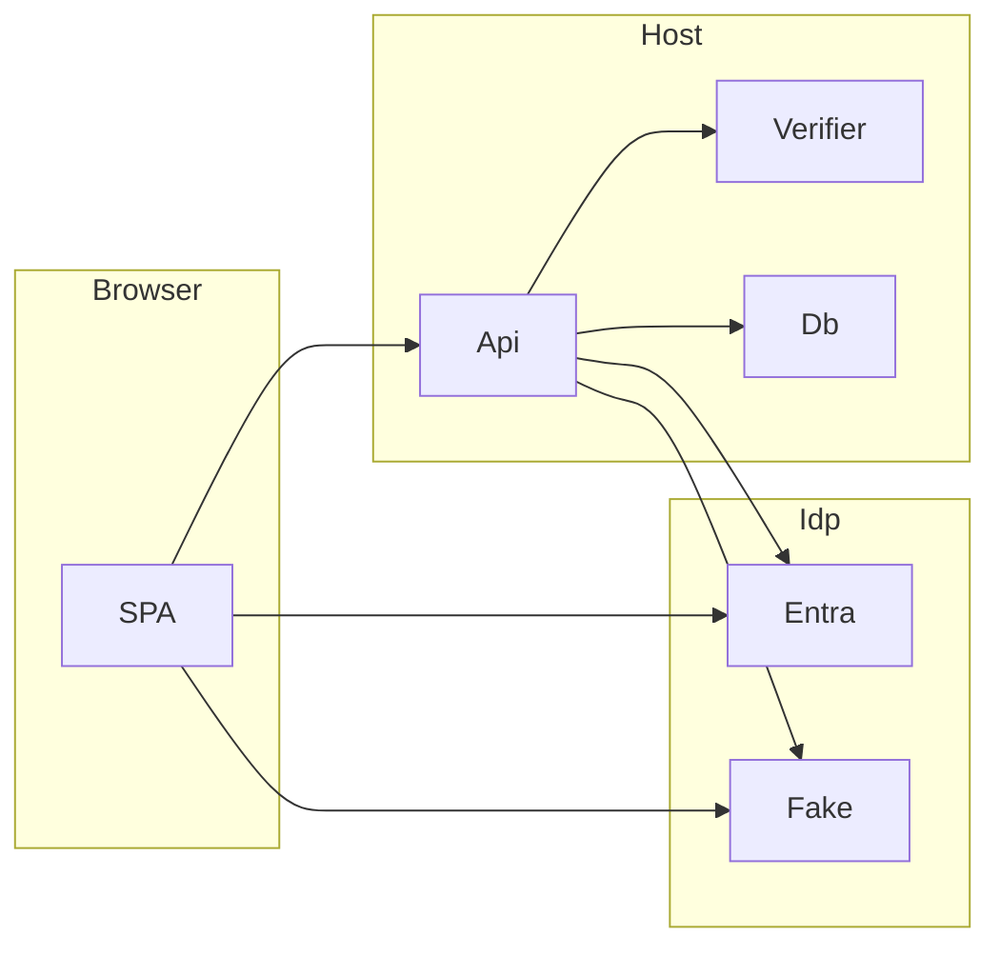

# Threat model (v1, design level)

Evidence anchor: `docs/architecture.md` (sections cited as A§n) and `docs/adr/`. No code exists yet, so "existing controls" are design commitments, not implemented behavior. M8 refreshes this file with code evidence. Every threat maps to an invariant and a named test in the milestone that builds the behavior. v1 follows the M1 T1.4 panel review.

## Executive summary

The main risks are spoofing the voice factor, weakening or bypassing the step-up, and handling biometric data. A single-use random phrase plus an ASR check stops replay of a whole earlier recording of a different phrase (ASR spike T3.1 done). It does not stop a recording that differs by one word: M6 measured that the letter-similarity rule accepts such a phrase 87% of the time. Two attacks have no control and are stated limits: words spliced from recordings of the victim (all but one of the 6 words suffice under the current rule, TM-001b), and a cloned or converted voice that reads the phrase. With the 6-word challenge (a probe of about 3 s) the speaker check alone rejects about 24% of genuine attempts on test-clean (43% at the earlier 4 words and 2 s), so the fresh-MFA fallback is used often and TM-005 and TM-012 still matter. The fallback rule was confirmed in the live Entra spike (M5 T5.4, ADR-0004) for one TOTP user. NIST SP 800-63B-4 says voice comparison SHALL NOT be used as a biometric authenticator, so this project is a demonstrator, not a conformant authenticator.

## Scope and assumptions

In scope: `StepUp.Api`, `StepUp.Core`, `StepUp.Infrastructure`, the Sherpa verifier, the SPA, the fake authority, the compose demo, the Entra integration, the model fetch script. Out of scope: Entra itself, the browser and OS, hosting, physical access to the host, production deployment.

Assumptions (conditional where marked):
- A1. Demonstrator only; no real customer data and no internet-exposed production deployment. If exposed, raise TM-010, TM-013, TM-016.
- A2. The Entra tenant and the user's primary sign-in are trusted for identity; voice is a step-up on top.
- A3. The host and its key ring are not compromised.
- A4. Single instance, single tenant per deployment.

Open questions that would change ranking: (a) will the demo ever be public? (b) does Entra honor the claims request and emit `amr` and `auth_time` for this API (M5 T5.4)? (c) does the longer-phrase and per-word-rule evaluation of M6b (Amendment 2) change the operating point and the near-miss rate?

## System model

### Primary components
SPA (browser), `StepUp.Api` (policy, challenge, assertion issuer), `IVerifier` (Sherpa in-process or `HttpVerifier`), SQLite store, Entra or `StepUp.FakeAuthority` (A§1).

### Data flows and trust boundaries
Each boundary lists its required controls (design, not yet built; A§1 has the full table).
- Browser → Api: bearer token, WAV upload, challenge id over HTTPS (HTTP in the local demo). Required controls: JWT validation (issuer, audience, `tid`, signature, lifetime, `scp`, roles, no app-only tokens), size and format checks, rate limiting, CORS allowlist.
- Browser → IdP: authorization code with PKCE, `claims` parameter for the fallback.
- Api → IdP: discovery and JWKS fetch over TLS, one issuer and one tenant.
- Api → Verifier: WAV and phrase; in-process, or `HttpVerifier` on loopback or the compose network with a shared secret. The verifier returns the probe embedding and transcript; the Api scores.
- Api → SQLite: embeddings (encrypted), consent, attempts, thresholds, challenges, used assertions.

#### Diagram

## Assets and security objectives

| Asset | Why it matters | Objective |
|---|---|---|
| Voiceprint embeddings | Biometric data (GDPR Art. 9) | C, I |
| Raw audio (in memory per request) | Biometric data; replay material | C |
| Step-up assertion and its signing key | Grants high-risk actions | I, C |
| Consent records | Legal proof | I |
| Attempt log | Analyst tuning, detection | I |
| Thresholds | Control accuracy of the factor | I |
| Challenges | Replay resistance | I |
| Availability of step-up | Users blocked from high-risk actions | A |

## Attacker model

### Capabilities
- Holds a valid low-assurance session for a victim (stolen token) or a recording of the victim's voice.
- Can call any API endpoint, send crafted audio, and replay requests.
- Can produce synthetic speech with off-the-shelf tools and splice recorded words.
- A malicious or curious analyst account.
- Can run script in the SPA origin if there is an XSS bug.

### Non-capabilities
- No host or key-ring access, no ability to alter Entra, no break of TLS or ES256.

## Entry points and attack surfaces

| Surface | How reached | Trust boundary | Notes | Evidence |
|---|---|---|---|---|
| `POST /api/stepup/verify` | Authenticated HTTP, WAV body | Browser → Api | Main attack surface | A§4 |
| `POST /api/stepup/challenge` | Authenticated HTTP | Browser → Api | Phrase issuance | A§4 |
| Enrollment endpoints | Authenticated HTTP, WAV | Browser → Api | Poisoning | A§2.1, A§4 |
| `DELETE /api/voiceprint` | Authenticated HTTP | Browser → Api | Deletion race, residue | A§2.4 |
| Analyst endpoints | Role-gated HTTP | Browser → Api | Threshold and log | A§4 |
| `POST /api/payouts` + assertion or fresh MFA | Authenticated HTTP | Browser → Api | Policy enforcement point | A§2.2, A§2.3 |
| `GET /api/me`, `GET /healthz` | HTTP | Browser → Api | Low risk; `/api/me` reveals enrollment state | A§4 |
| Fake-authority authorize and token endpoints | HTTP | Browser → Fake | Mints any identity by design | A§1 |
| PKCE sign-in flow | Browser redirects | Browser → IdP | Redirect URI type `spa` | A§1 |
| Configuration (`Auth:Mode`, threshold seeds, limits) | Files, environment | Operator → Api | Threshold manipulation, Fake mode | A§1 |
| Model fetch script | Network at build or first run | Operator → Net | Supply chain; checksum-verified | A§7 |
| SPA static hosting | HTTP | Browser → web | CSP, token storage | A§7 |
| WAV parser | Inside verify and sample | Api internal | Malformed audio (parser not yet chosen) | A§5 |
| Logs and telemetry | Process output | Api → ops | Leakage | A§3 |

## Top abuse paths

1. Replay: record a prior attempt → submit it for a new challenge → fails because the phrase differs and the old challenge is consumed.
2. Splice or clone: collect words or voice samples of the victim → splice or synthesize the new phrase → pass the speaker and ASR checks → obtain assertion (residual risk, no anti-spoofing).
3. Enrollment poisoning: attacker with a stolen low-assurance session enrolls own voice for the victim → blocked only if enrollment needs fresh MFA and the samples must be one speaker.
4. Forge or reuse: craft an `amr=vbm` JWT, reuse an assertion for another action or payload, or present an Entra token → must fail signature, `typ`, `aud`, `act`, single-use and bearer-binding checks.
5. Downgrade: force verifier errors or exhaust attempts → push the user to the fallback → attacker with a stale-MFA session passes if the fallback trusts `iat` (design uses `auth_time` only).
6. Tamper: analyst or attacker lowers the threshold, seeds it through config, or edits attempts → accept bad voices or hide abuse.
7. Race: replay a verify call while a deletion is in flight → assertion for a deleted voiceprint.
8. Leak: raw audio, transcript or scores appear in logs, telemetry or the failure response.
9. Malformed or abundant audio: oversized or crafted WAV, or many parallel requests → crash or exhaustion.
10. Fake mode in a real deployment: anyone mints tokens for any `oid` with an `mfa` amr.

## Threat model table

| Threat ID | Threat source | Prerequisites | Threat action | Impact | Impacted assets | Existing controls (design) | Gaps | Recommended mitigations | Detection ideas | Likelihood | Impact severity | Priority |
|---|---|---|---|---|---|---|---|---|---|---|---|---|
| TM-001 | Remote attacker | Recordings of the victim saying the phrase, or each word | Replay a whole earlier clip | Step-up bypass | Assertion, challenges | Single-use random 6-word phrase from a word list, ASR check (A§2.2, A§5, ADR-0002). This is whole-clip replay resistance, not liveness and not presentation attack detection | Measured (ADR-0002, M6 R4): 0% of wrong whole phrases accepted at similarity 0.60, but a phrase with one wrong word is accepted 85.02% (dev-clean) and 87.00% (test-clean) of the time, and correct phrases 96.04% and 99.55%; not measured on microphone speech. Splicing is not stopped (TM-001b) | Enrollment words kept out of the challenge list (tested); challenge bound to user and action; the 0.60 rule was re-checked in M6 (see Gaps); a per-word rule was evaluated in M6b Amendment 2 and stays off because no floor met its gate (ADR-0002), control still partial | Repeated `PhraseMismatch` per user in the log | Medium | High | high |
| TM-001b | Remote attacker | Recordings of the victim saying many challenge words (past attempts; the challenge list is a fixed 256 words) | Splice recorded words into one clip for a fresh phrase | Step-up bypass | Assertion, challenges | Same controls as TM-001; the 6-word phrase raises the number of words an attacker must hold (48 bits) | Not stopped. The phrase rule accepts a phrase with one wrong word 85.02% (dev-clean) and 87.00% (test-clean) of the time (sentences of 3 to 6 words, not 6 challenge words), so an attacker needs fewer than 6 words. The per-word rule, `StepUp:PhraseMinWordSimilarity`, would narrow it but no floor from 0.50 to 0.70 met its gate on dev-clean (ADR-0002, Amendment 2), so it is off. Splicing is not measured in M6 | Challenge words kept out of the enrollment list; per-word rule implemented and ready if a later measurement qualifies a floor | Repeated `PhraseMismatch` per user in the log | Medium | High | high |
| TM-002 | Remote attacker | Voice samples; TTS or conversion tool | Synthetic or converted voice reads the phrase | Step-up bypass | Assertion | None (no anti-spoofing; A§5) | No countermeasure | State the limit in README; voice stays a second factor; evaluation reports spoof coverage as not measured | Score distribution drift | Medium | High | high |
| TM-003 | Remote attacker | Stolen low-assurance session, `Enroll_WithdrawThenComplete_ReturnsConsentMissingAndStoresNoVoiceprint`, `Enroll_WithdrawThenSample_ReturnsConsentMissing` | Enroll attacker voice for the victim | Persistent bypass | Voiceprints | Enrollment needs fresh MFA; enrollment id bound to the user; samples must pass the consistency floor (A§2.1) | The consistency floor (0.43 for the 3.5 s enrollments of 6-word phrases, the 1st percentile of genuine enrollments on dev-clean, M6 Amendment 2) has no poisoned-enrollment measurement; the first report's 0.46 floor on 2.5 s enrollments caught 47.5% of poisoned enrollments on test-clean, so 52.5% passed; fallback rule confirmed once in the live spike (ADR-0004) | Same `auth_time` rule as the fallback; reject mixed-speaker samples; fresh MFA on enroll is the main control | Enrollment events in the attempt log | Medium | High | high |
| TM-004 | Analyst or attacker | Analyst role, config write or DB write | Lower the threshold or edit the log | Weak factor, hidden abuse | Thresholds, attempts | Role-gated endpoints; bounds 0.0 to 1.0 with a floor; append-only attempts (A§3, A§4) | Config seeding path | Thresholds not hardcoded; every change records `UpdatedBy`; analyst role in Fake mode only via demo tokens | Alert on threshold change | Low | High | medium |
| TM-005 | Remote attacker | Stolen session; ability to cause verifier errors | Force the fallback and pass it with stale MFA | Downgrade | Fallback, availability | Fail closed (A§6); fallback needs `mfa` or `ngcmfa` and `auth_time` within N minutes, missing `auth_time` fails (A§2.3) | Entra behavior confirmed once (ADR-0004: `mfa` and `totp` in `amr`, `auth_time` advances after a fresh prompt; `ngcmfa` not issued to a TOTP user). Because about 24% of genuine 6-word attempts fall back (test-clean, condition L3E; 43% at the earlier 4 words), this path is used often | Fallback tests on the fake authority (M2) and the live tenant (M5) | Spike in `VerifierError`/`Timeout`; fallback attempts logged with `Mode=fallback` | High | High | high |
| TM-006 | Remote attacker | Valid bearer token, `Payout_ReplayedAndTamperedAssertions_AreLoggedWithTheirOwnReason` | Forge, replay or repurpose the `vbm` assertion | Action authorized without voice, or for another action or payload | Assertion | ES256 only, `typ`, `aud`, `act`, optional payload hash, single use via `UsedAssertions`, bearer binding, own key set (A§4, ADR-0005) | None beyond key handling (TM-014) | Validator pins algorithm and key set; reject `none`, HS256, unknown `kid` | Reused `jti` | Low | High | medium |
| TM-007 | Remote attacker | Entra token or assertion | Token confusion between Entra tokens and the assertion | Bypass | Assertion | Separate handlers, `aud` and `typ`; a `vbm` inside an Entra token is never accepted (A§1) | None yet | Both handlers reject the other's token | Wrong-`aud` rejections | Low | High | medium |
| TM-008 | Remote attacker or user | Concurrent requests; file access | Race deletion against verify; read deleted data from the DB file | Assertion for deleted voiceprint; biometric residue | Voiceprints, consent | Delete removes the row; `secure_delete` on; attempts pseudonymised (A§2.4, A§3) | Assertion issued before deletion stays valid up to 5 min | Verify reads embedding and consent in one transaction; state the 5-minute limit | None | Low | Medium | low |
| TM-009 | Insider or operator | Log or telemetry access | Raw audio, transcript or scores leak | Biometric exposure | Raw audio, embeddings | Application logs and telemetry carry no audio, transcript or score; the attempt store holds scores for the analyst role only (A§3) | None yet | Never log request bodies; scrub exceptions | Log scan in CI | Medium | High | high |
| TM-010 | Remote attacker | Network access, valid token | Oversized or crafted WAV; many parallel requests | DoS of all users, forced fallback | Availability | Size and format limits; per-user rate limits on `sample`, `challenge`, `verify`; cap on open challenges; global verifier concurrency limit; timeout (A§4, A§6) | Parser not chosen; ASR on a 10 s clip may exceed the 3 s timeout | Hard limits before parse; measure embedding plus ASR p95 in T3.1 | 413, 415, 429 counts | Medium | Medium | medium |
| TM-011 | Host compromise | File access | Read or lose embeddings or the key ring | Biometric exposure, forced re-enroll | Embeddings | Data Protection encryption (ADR-0006); `UserKey` is an HMAC | Key ring location | Key ring outside repo and image; permissions; secret scanner in CI | Not detectable here | Low | High | medium |
| TM-012 | Remote attacker | Valid session, `Attempts_ASuccessfulFallbackResetsTheCounter`, `Verify_WhileLockedOut_IsLogged_AndDoesNotExtendTheFailureCount` | Brute-force the voice factor, or lock a victim's voice | Eventually pass, or victim pushed to fallback | Assertion, availability | 5 fails → 30 s delay; 50 → voice disabled; counter resets on any successful step-up; re-enable by re-enrollment with fresh MFA; per-user primary, per-IP secondary (A§4) | Lockout is a nuisance path to the fallback, and with a genuine false reject of about 24% (6-word challenge, test-clean) honest users reach the 5-failure delay now and then. Brute force with the attacker's own voice: at the 2.18% false accept rate of the 6-word condition on test-clean (threshold 0.80; 0.73% on dev-clean), up to 50 attempts pass at least once with probability 1 - 0.9782^50, about 67% if trials were independent (about 31% at the dev-clean rate) (UNVERIFIED: speaker difficulty varies, and a successful step-up resets the counter) | Keep the fallback strong (TM-005). The defaults 5 / 30 s / 50 are the NIST ceiling for a system without presentation attack detection and are configurable; stricter limits (for example voice disabled after about 10 failures) are an option, not applied | `RateLimited` counts | High | Medium | high |
| TM-013 | Operator error or attacker | Misconfigured deployment, `Startup_RefusesEntraModeWithoutAGuidTenantId` | Fake mode runs outside a demo, or Entra mode trusts the fake issuer | Total auth bypass, analyst role included | All | Fake mode needs an explicit demo flag in Development or on loopback or compose; Entra mode accepts one issuer and one `tid`; fake key per run (A§1) | Not implemented | Startup refusal; startup log names the mode | Startup log line | Low | High | high |
| TM-014 | Host or repo exposure | Access to key material | Steal or swap the ES256 assertion key | Forge any assertion | Signing key | Key generated at first start, Data Protection in the volume, `kid`, manual rotation, never in repo or image (A§4, ADR-0005) | Rotation is manual | Pin `alg`; secret scanner in CI; check image layers | Unknown `kid` rejections | Low | High | high |
| TM-015 | Network attacker or rogue service | Access to the verifier hop | Spoof `HttpVerifier` or read WAV in transit | Fake pass, biometric exposure | Audio, assertion | Loopback or compose network, shared-secret header, no body logging; the Api scores from the returned embedding (A§1) | Owner is M3 T3.7 | Never send the stored embedding to the verifier | Verifier auth failures | Low | Medium | low |
| TM-016 | Remote attacker | XSS in the SPA | Read tokens and assertion, call the API as the user | Account misuse | Bearer, assertion | CSP; no `localStorage` for tokens (the access token is memory-only; `sessionStorage` holds only the PKCE verifier and state for one redirect and the sign-in login hint, an identity routing value, not a credential); CORS allowlist; short assertion life; no cookies so no CSRF (A§7) | The binding stops cross-user use only, not same-session theft | Keep dependencies minimal; strict CSP | CSP violation reports | Low | Medium | medium |
| TM-017 | Remote attacker | Valid session | Use failure detail as an oracle to tune synthetic audio | Faster cloning | Assertion | One generic `VerificationFailed`; both checks always run; score and threshold never returned (A§4) | Timing differences | Test response uniformity | Many failed attempts per user | Medium | Medium | medium |

## Criticality calibration

- critical: unauthenticated step-up bypass; signing key theft; mass embedding exfiltration. Examples: assertion accepted without bearer token; key committed to the repo; embeddings readable in the DB file.
- high: bypass needing one realistic precondition. Examples: replay or splicing passes (TM-001); voice cloning (TM-002); enrollment hijack (TM-003); stale-MFA fallback (TM-005).
- medium: weakening or DoS needing privilege or effort. Examples: threshold tampering; forced fallback; large-audio DoS.
- low: narrow races, minor leaks. Examples: deletion race; wrong-`aud` info leak.

## Focus paths for security review

| Path | Why it matters | Related Threat IDs |
|---|---|---|
| `src/StepUp.Core` challenge service | Single use and binding | TM-001, TM-012 |
| `src/StepUp.Api` assertion issuer and validator | Forgery, confusion, key | TM-006, TM-007, TM-014 |
| `src/StepUp.Api` auth setup and fallback | Fake mode, downgrade | TM-005, TM-013 |
| `src/StepUp.Api` enrollment | Poisoning and consent | TM-003, TM-008 |
| `src/StepUp.Infrastructure` | Encryption, deletion | TM-008, TM-011 |
| `src/StepUp.Verifier.Sherpa` and WAV ingest | Parser, timeout, hop | TM-010, TM-015 |
| Logging configuration and failure responses | Leakage, oracle | TM-009, TM-017 |
| Analyst endpoints and config | Threshold integrity | TM-004 |
| `web/` | XSS, token storage | TM-016 |

## Invariants and tests by milestone

| Threat | Invariant | Named test or check | Milestone |
|---|---|---|---|
| TM-001 | A challenge verifies at most once and only for its user and action | `Challenge_IsSingleUse`, `Challenge_ExpiresAfter60s`, `Challenge_RejectsOtherUser`, `Challenge_RejectsOtherAction`, `Challenge_ConcurrentVerify_OnlyOneSucceeds`, `Verify_RejectsPhraseMismatch`, `EnrollmentAndChallengeWordlists_ShareNoWords`, `EnrollmentPhrases_AreEnrollmentWordsAndNeverChallengeWords`, `Verify_ExpiredChallenge_IsLoggedAsRefused` | M2, M3 |
| TM-001b | Splicing is a stated limit: a phrase with one wrong word is accepted | `PhraseCheck_OneWrongWord_IsAcceptedAsADocumentedLimit` | M3 |
| TM-002 | None (limit stated) | README limit present; evaluation report lists spoofing as not measured | M6, M8 |
| TM-003 | Enroll or replace needs fresh MFA, an owned enrollment id and consistent speakers | `Enroll_RequiresFreshMfa`, `Enroll_RequiresConsent`, `Enroll_RejectsOtherUsersEnrollmentId`, `Enroll_RejectsInconsistentSpeakers` | M2, M3, M5 |
| TM-004 | Threshold within bounds; every change recorded; log append only; analyst endpoints reject the user role | `Thresholds_RejectOutOfRange`, `Thresholds_RecordUpdatedBy`, `Thresholds_NotHardcoded`, `Analyst_EndpointsRejectUserRole`, `Attempts_HasNoUpdateOrDeletePath` | M2 |
| TM-005 | Verifier error or timeout never passes; fallback needs fresh `auth_time` and `mfa`/`ngcmfa` | `Verify_FailsClosedOnTimeout`, `Verify_FailsClosedOnVerifierError`, `Fallback_RejectsStaleAuthTime`, `Fallback_RejectsMissingAuthTime`, `Fallback_RejectsAmrWithoutMfa`, `Fallback_AcceptsFreshMfa`; live check in the T5.4 spike | M2, M5 |
| TM-006 | Assertion rejected if tampered, expired, replayed, wrong user, wrong action, changed payload, or without bearer | `Assertion_RejectsWrongAction`, `Assertion_RejectsChangedPayload`, `Assertion_IsSingleUse`, `Assertion_RejectsAlgNone`, `Assertion_RejectsHs256`, `Assertion_RejectsUnknownKid`, plus tamper, expiry, wrong-user, missing-bearer tests (T2.3) | M2 |
| TM-007 | Entra tokens are not accepted as assertions and the reverse | `Assertion_RejectsEntraToken`, `Bearer_RejectsStepUpAssertion` | M2 |
| TM-008 | Verify after delete returns `NoVoiceprint`; no embedding bytes remain in the DB file | `Verify_AfterDelete_ReturnsNoVoiceprint`, concurrent variant, `Delete_LeavesNoEmbeddingBytesInDbFile`, `Withdrawal_PseudonymisesAttemptsButKeepsTheRows`, `Attempts_Pseudonymise_ReKeysOnlyThatUsersRowsToRandomTokens_KeepingTheRest`, `Enrollment_DeleteForUser_RemovesOnlyThatUsersRows` | M2, M7 |
| TM-009 | No audio, transcript or score in application logs | Log-capture test over a full flow | M2, M7 |
| TM-010 | Audio over limits is rejected before parsing; verifier concurrency is bounded | `Wav_RejectsOversize`, `Wav_RejectsBadFormat`, `Verifier_ConcurrencyLimitReturns429` | M3 |
| TM-011 | Stored embedding is not plaintext; key ring and signing key are outside the repo and image | `Embedding_IsEncryptedAtRest`; secret scan in CI; image-layer check | M2, M8 |
| TM-012 | 5 failures delay, 50 disable voice; reset and re-enable rules hold | `Attempts_DelayAfter5`, `Attempts_DisableAfter50`, `Attempts_ResetOnSuccess` | M2 |
| TM-013 | Fake mode refused outside demo; Entra mode rejects the fake issuer | `Startup_RefusesFakeModeOutsideDemo`, `EntraMode_RejectsFakeIssuerToken` | M2, M5 |
| TM-014 | Assertion key is never in the repo or image | Secret scan in CI; `Assertion_RejectsUnknownKid` | M2, M8 |
| TM-015 | `HttpVerifier` hop is authenticated and the stored embedding never leaves the Api | `HttpVerifier_RejectsMissingSecret`; contract suite | M3 |
| TM-016 | CSP header present; CORS allows only the SPA origin; no token in `localStorage` | `Cors_RejectsOtherOrigins` (M2); CSP header test and storage check (M4) | M2, M4 |
| TM-017 | Failure response is identical for phrase and score failures | `Verify_FailResponse_IsUniform`, `Verify_HighScorePhraseMismatch_NoAssertion`, `Verify_BelowThreshold_NoAssertion`, `Verify_ModelIdMismatch_ReturnsReEnrollRequired` | M2 |

## Notes on use

v1 is a design review. Re-run with code evidence in M8 (T8.2). Treat A1 as the assumption most likely to change priorities.
