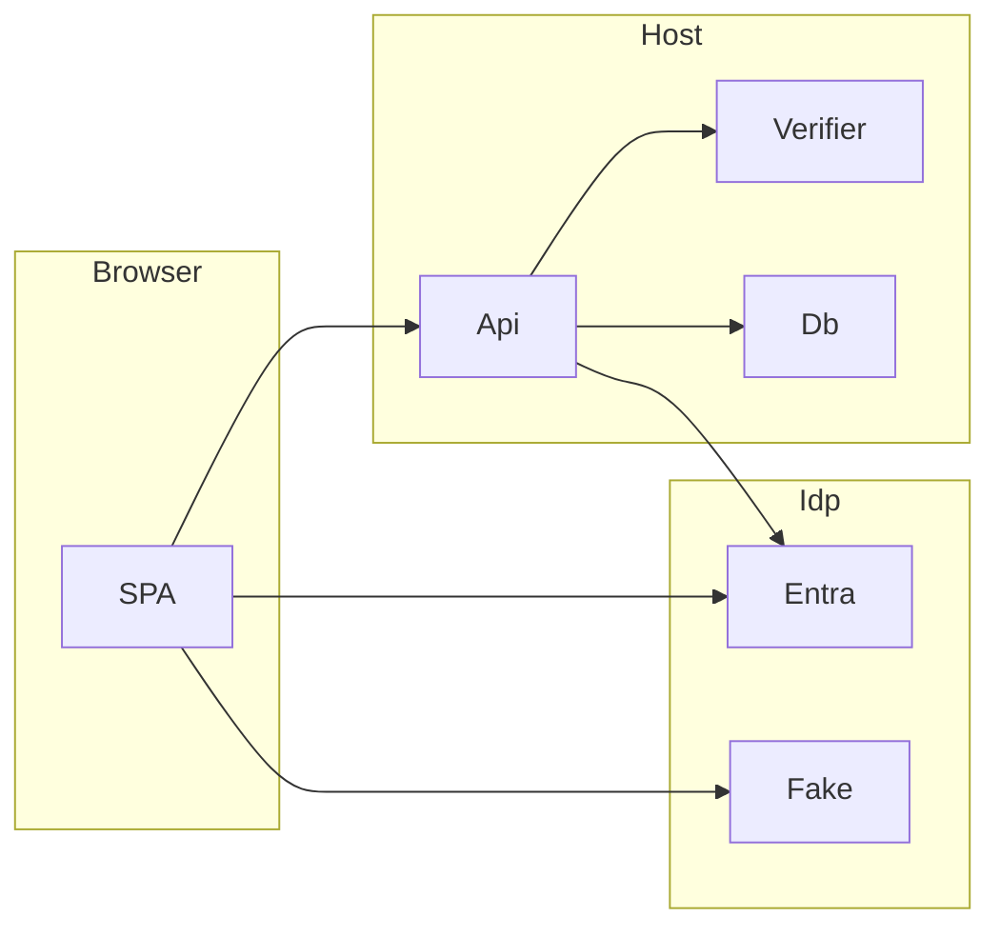

# Threat model (v0, design level)

Evidence anchor: `docs/architecture.md` (sections cited as A§n) and `docs/adr/`. No code exists yet, so "existing controls" are design commitments, not implemented behavior. M8 refreshes this file with code evidence. Every threat maps to an invariant and a named test in the milestone that builds the behavior.

## Executive summary

The main risks are spoofing the voice factor (replay, synthetic or cloned voice), weakening or bypassing the step-up (forged assertion, fallback downgrade, threshold tampering), and handling biometric data (embeddings, consent, audio leakage). Replay is addressed by a single-use random phrase plus an ASR check. Cloned voice that reads the phrase has no control; this is a stated limit. NIST SP 800-63B-4 says voice comparison SHALL NOT be used as a biometric authenticator, so this project is a demonstrator, not a conformant authenticator.

## Scope and assumptions

In scope: `StepUp.Api`, `StepUp.Core`, `StepUp.Infrastructure`, the Sherpa verifier, the SPA, the fake authority, the compose demo, the Entra integration. Out of scope: Entra itself, the browser and OS, hosting, physical access to the host, production deployment.

Assumptions (conditional where marked):
- A1. Demonstrator only; no real customer data and no internet-exposed production deployment. Rankings assume this. (If exposed, raise TM-003, TM-010.)
- A2. The Entra tenant and the user's primary sign-in are trusted for identity; voice is a step-up on top.
- A3. The host and its Data Protection key ring are not compromised.
- A4. Single instance, single tenant per deployment.

Open questions that would change ranking: (a) will the demo ever be public? (b) does Entra put `amr`/`auth_time` in the access token for this API (M5 T5.4)? (c) what ASR model passes the M3 spike (T3.1)?

## System model

### Primary components
SPA (browser), `StepUp.Api` (policy, challenge, assertion issuer), `IVerifier` (Sherpa in-process or `HttpVerifier`), SQLite store, Entra or `StepUp.FakeAuthority` (A§1).

### Data flows and trust boundaries
- Browser → Api: bearer token, WAV upload, challenge id over HTTPS (HTTP in local demo). Guarantees: JWT validation (issuer, audience, `tid`, signature, lifetime), size and format checks, rate limiting.
- Api → IdP: discovery and JWKS fetch. Guarantee: TLS, issuer pinning by configuration.
- Api → Verifier: WAV and phrase; in-process or HTTP. Guarantee: timeout fails closed.
- Api → SQLite: embeddings (encrypted), consent, attempts, thresholds, challenges. Guarantee: Data Protection encryption, no raw audio.

#### Diagram

## Assets and security objectives

| Asset | Why it matters | Objective |
|---|---|---|
| Voiceprint embeddings | Biometric data (GDPR Art. 9) | C, I |
| Raw audio (in memory per request) | Biometric data; replay material | C |
| Step-up assertion and signing key | Grants high-risk actions | I, C |
| Consent records | Legal proof | I |
| Attempt log | Analyst tuning, detection | I |
| Thresholds | Control accuracy of the factor | I |
| Challenges | Liveness | I |
| Availability of step-up | Users blocked from high-risk actions | A |

## Attacker model

### Capabilities
- Holds a valid low-assurance session for a victim (stolen token) or a recording of the victim's voice.
- Can call any API endpoint, send crafted audio, and replay requests.
- Can produce synthetic speech with off-the-shelf tools.
- A malicious or curious analyst account.

### Non-capabilities
- No host or key-ring access, no ability to alter Entra, no break of TLS or ES256.

## Entry points and attack surfaces

| Surface | How reached | Trust boundary | Notes | Evidence |
|---|---|---|---|---|
| `POST /api/stepup/verify` | Authenticated HTTP, WAV body | Browser → Api | Main attack surface | A§4 |
| `POST /api/stepup/challenge` | Authenticated HTTP | Browser → Api | Phrase issuance | A§4 |
| Enrollment endpoints | Authenticated HTTP, WAV | Browser → Api | Poisoning | A§2.1, A§4 |
| `DELETE /api/voiceprint` | Authenticated HTTP | Browser → Api | Deletion race | A§2.4 |
| Analyst endpoints | Role-gated HTTP | Browser → Api | Threshold and log | A§4 |
| `POST /api/payouts` + assertion | Authenticated HTTP | Browser → Api | Policy enforcement point | A§2.2 |
| JWKS and discovery fetch | Outbound HTTP | Api → IdP | Key confusion | A§1 |
| WAV parser | Inside verify and sample | Api internal | Malformed audio | A§5 |
| Logs and telemetry | Process output | Api → ops | Audio or score leakage | A§3 |

## Top abuse paths

1. Replay: record a prior attempt → submit it for a new challenge → fails because the phrase differs and the old challenge is consumed.
2. Clone: obtain victim voice samples → synthesize the new phrase → pass the speaker and ASR checks → obtain assertion (residual risk, no anti-spoofing).
3. Enrollment poisoning: attacker with a stolen low-assurance session enrolls own voice for the victim → later passes step-up as the victim.
4. Forge: craft an `amr=vbm` JWT or reuse an Entra token's claims → present at the payout endpoint → must fail signature, audience and bearer-binding checks.
5. Downgrade: force verifier errors or exhaust attempts → push the user to the fallback → attacker with a stolen session completes weaker MFA or none.
6. Tamper: analyst or attacker lowers the threshold or edits attempts → accept bad voices or hide abuse.
7. Race: replay a verify call while a deletion is in flight → assertion issued for a deleted voiceprint.
8. Leak: raw audio or scores appear in logs, exception text or telemetry.
9. Malformed audio: oversized or crafted WAV → crash or resource exhaustion in the parser or verifier.

## Threat model table

| Threat ID | Threat source | Prerequisites | Threat action | Impact | Impacted assets | Existing controls (evidence) | Gaps | Recommended mitigations | Detection ideas | Likelihood | Impact severity | Priority |
|---|---|---|---|---|---|---|---|---|---|---|---|---|
| TM-001 | Remote attacker | Recording of victim speaking | Replay a recorded phrase | Step-up bypass | Assertion, challenges | Single-use random 4-word phrase, 60 s TTL, ASR check (A§2.2, ADR-0002) | ASR spike pending | Consume challenge atomically; ASR match required | Repeated `PhraseMismatch` per user | Medium | High | high |
| TM-002 | Remote attacker | Voice samples; TTS or cloning tool | Synthetic voice reads the phrase | Step-up bypass | Assertion | None (no anti-spoofing; A§5) | No countermeasure | State the limit in README; keep voice a second factor only; log scores | Score distribution drift in analyst log | Medium | High | high |
| TM-003 | Remote attacker | Stolen low-assurance session | Enroll attacker voice for the victim | Persistent bypass | Voiceprints | Consent flow (A§2.1) | Enrollment strength not specified | Require fresh MFA to enroll or replace a voiceprint; one voiceprint per user | Enrollment events in attempt log | Medium | High | high |
| TM-004 | Analyst or attacker | Analyst role or DB write | Lower the threshold or edit the log | Weak factor, hidden abuse | Thresholds, attempts | Role-gated endpoints (A§4) | No audit of threshold changes | Bounds on threshold, `UpdatedBy`, append-only log, history | Alert on threshold change | Low | High | medium |
| TM-005 | Remote attacker | Ability to cause verifier errors | Force timeout or errors to push users to fallback | Downgrade | Availability, fallback | Fail closed (A§6) | Fallback strength depends on Entra | Fallback requires fresh `ngcmfa`/`mfa`; never pass on error | Spike in `VerifierError`/`Timeout` | Medium | Medium | medium |
| TM-006 | Remote attacker | Valid bearer token | Forge or replay the `vbm` assertion | Action authorized without voice | Assertion, signing key | ES256, `jti`, 5 min, bearer binding (A§4, ADR-0005) | Key storage and rotation unspecified | Validate `iss`, `aud`, `oid`, `tid`, `jti` once; protect key | Reused `jti` | Low | High | medium |
| TM-007 | Remote attacker | Entra token | Treat Entra `amr` as the service assertion, or the reverse | Token confusion | Assertion | Separate issuer and audience (ADR-0005) | None yet | Distinct `aud`, `typ`; reject Entra tokens at assertion check | Wrong-`aud` rejections | Low | High | medium |
| TM-008 | Remote attacker or user | Concurrent requests | Race deletion against verify or enrollment | Assertion for deleted voiceprint | Voiceprints, consent | Delete removes the row (A§2.4) | No transaction rule stated | Verify reads the embedding inside a transaction with consent check | None | Low | Medium | low |
| TM-009 | Insider or operator | Log or telemetry access | Raw audio, transcript or scores leak | Biometric exposure | Raw audio, embeddings | No audio persisted; no audio in logs (A§3) | None yet | Never log request bodies; scrub exceptions | Log scan in CI | Medium | High | high |
| TM-010 | Remote attacker | Network access | Oversized or crafted WAV | DoS, parser bug | Availability | Size and format limits (A§4) | Parser not chosen | Hard limits before parse; verifier timeout; rate limit | 413/415 counts | Medium | Medium | medium |
| TM-011 | Host compromise | File access | Read or lose embeddings or key ring | Biometric exposure, forced re-enroll | Embeddings | Data Protection encryption (ADR-0006) | Key ring location | Key ring outside repo and image; permissions | Not detectable here | Low | High | medium |
| TM-012 | Remote attacker | Valid session | Brute-force the voice factor | Eventually pass | Assertion | 5 fails → 30 s delay; 50 → disabled (A§4) | Limits per user only | Add per-IP rate limit | `RateLimited` counts | Medium | Medium | medium |

## Criticality calibration

- critical: unauthenticated step-up bypass; signing key theft; mass embedding exfiltration. Examples: assertion accepted without bearer token; key committed to the repo; embeddings readable in the DB file.
- high: bypass needing one realistic precondition. Examples: replay passes (TM-001); voice cloning (TM-002); enrollment hijack (TM-003).
- medium: weakening or DoS needing privilege or effort. Examples: threshold tampering; forced fallback; large-audio DoS.
- low: narrow races, minor leaks. Examples: deletion race; wrong-`aud` info leak.

## Focus paths for security review

| Path | Why it matters | Related Threat IDs |
|---|---|---|
| `src/StepUp.Core` challenge service | Single use and binding | TM-001, TM-012 |
| `src/StepUp.Api` assertion issuer and validator | Forgery and confusion | TM-006, TM-007 |
| `src/StepUp.Api` enrollment | Poisoning and consent | TM-003, TM-008 |
| `src/StepUp.Infrastructure` | Encryption, deletion | TM-008, TM-011 |
| `src/StepUp.Verifier.Sherpa` and WAV ingest | Parser and timeout | TM-005, TM-010 |
| Logging configuration | Leakage | TM-009 |
| Analyst endpoints | Threshold integrity | TM-004 |

## Invariants and tests by milestone

| Threat | Invariant | Named test or check | Milestone |
|---|---|---|---|
| TM-001 | A challenge verifies at most once and only for its user and action | `Challenge_IsSingleUse`, `Challenge_ExpiresAfter60s`, `Verify_RejectsPhraseMismatch` | M2, M3 |
| TM-002 | None (limit stated) | README limit present; evaluation report states no anti-spoofing | M6, M8 |
| TM-003 | Enroll or replace needs fresh MFA and consent | `Enroll_RequiresFreshMfa`, `Enroll_RequiresConsent` | M2, M7 |
| TM-004 | Threshold within bounds; every change recorded | `Thresholds_RejectOutOfRange`, `Thresholds_RecordUpdatedBy` | M2 |
| TM-005 | Verifier error or timeout never passes | `Verify_FailsClosedOnTimeout`, `Verify_FailsClosedOnVerifierError` | M2, M7 |
| TM-006 | Assertion rejected if tampered, expired, replayed, wrong user, or without bearer | Tamper, expiry, wrong-user, replay, missing-bearer tests (T2.3) | M2 |
| TM-007 | Entra tokens are not accepted as assertions | `Assertion_RejectsEntraToken` | M2 |
| TM-008 | Verify after delete returns `NoVoiceprint` | `Verify_AfterDelete_ReturnsNoVoiceprint`, concurrent variant | M2, M7 |
| TM-009 | No audio, transcript or score in logs | Log-capture test over a full flow | M2, M7 |
| TM-010 | Audio over limits is rejected before parsing | `Wav_RejectsOversize`, `Wav_RejectsBadFormat` | M3 |
| TM-011 | Stored embedding is not plaintext; key ring is outside the repo | `Embedding_IsEncryptedAtRest`; `git grep` check | M2, M8 |
| TM-012 | 5 failures delay, 50 disable voice | `Attempts_DelayAfter5`, `Attempts_DisableAfter50` | M2 |

## Notes on use

v0 is a design review. Re-run with code evidence in M8 (T8.2). Treat A1 as the assumption most likely to change priorities.
